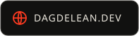
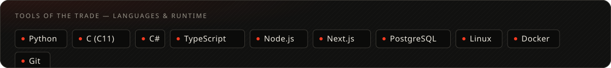
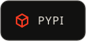

  
  &nbsp;
  
  &nbsp;
  
  &nbsp;
  

 

<picture>
  <source media="(prefers-color-scheme: dark)" srcset="assets/h-currently-dark.svg">
  
</picture>

- **Founder** @ **Pollykoo Agency** — end-to-end websites for small businesses · since 2024
- **Board of directors** @ **OMÜ Siber** — the cyber security community at Ondokuz Mayıs University
- **B.Sc. Information Security Technology** @ OMÜ · 2025–2029 · heading toward red team work
- Currently in the lab: Windows internals & the Win32 API, Active Directory attack paths, applied cryptography

 

<picture>
  <source media="(prefers-color-scheme: dark)" srcset="assets/h-projects-dark.svg">
  
</picture>

  
  

  
  

More on the tools and write-ups: <a href="https://github.com/dagdelenemre/nopanic">nopanic</a> · <a href="https://github.com/dagdelenemre/bicbic416">bicbic416</a> · <a href="https://pypi.org/user/dagdelean/">PyPI</a> · <a href="https://dagdelean.dev">the full operator file</a>

  

<picture>
  <source media="(prefers-color-scheme: dark)" srcset="assets/h-stack-dark.svg">
  
</picture>

  

<picture>
  <source media="(prefers-color-scheme: dark)" srcset="assets/h-contact-dark.svg">
  
</picture>

Offensive-security internships, white-label / overflow web work, or a debate about circuit breakers — pick a protocol.

  
  &nbsp;
  
  &nbsp;
  
  &nbsp;
  

Based in Atakum, Samsun · TR · UTC+3 · open to remote work · <code>tr</code> / <code>en</code>
